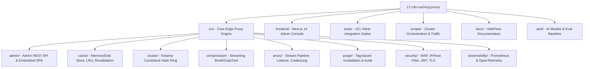

# Project Directory Map & Dependency Audit



---

## 1. Directory Tree & File Inventory

```
17-cdn-caching-proxy/
├── package.json                    # Project configuration, scripts, dependencies
├── tsconfig.json                   # TypeScript compiler configuration (ESNext, NodeNext)
├── Dockerfile                      # Multi-stage production container build
├── docker-compose.yml              # Cluster definition (Proxy, Admin, 3 Mock Origins)
├── README.md                       # Repository overview and quickstart guide
├── FEATURES.md                     # Master checklist of 152 implemented features
│
├── src/                            # Core Reverse Caching Proxy Engine
│   ├── admin/                      # Control plane HTTP server & dashboard
│   │   ├── server.ts               # Admin REST API HTTP server (Port 9090)
│   │   ├── dashboard-html.ts       # Embedded zero-dependency SPA dashboard HTML
│   │   ├── metrics-history.ts      # Circular buffer for time-series metrics
│   │   ├── routes-manager.ts       # Dynamic upstream route configuration
│   │   ├── policy-manager.ts       # Route-level cache policy overrides
│   │   └── request-inspector.ts    # Ring buffer of recent caching decisions
│   ├── cache/                      # RFC 9111 Caching Subsystem
│   │   ├── store.ts                # CacheStore abstract interface and data types
│   │   ├── memory-store.ts         # In-memory segment cache with byte quotas
│   │   ├── disk-store.ts           # Disk-backed file store with metadata index
│   │   ├── compaction.ts           # Background disk segment compaction engine
│   │   ├── lookup.ts               # Canonical cache key lookup & Vary evaluation
│   │   ├── serve.ts                # Cache hit, 304 revalidation, and stale response writer
│   │   ├── fill.ts                 # Tee-stream writer to store in-flight responses
│   │   ├── freshness.ts            # RFC 9111 age and freshness lifetime calculus
│   │   ├── cache-control.ts        # Cache-Control directive lexer and parser
│   │   ├── etag.ts                 # Strong and weak ETag generator and validator
│   │   ├── lifetime.ts             # Heuristic freshness calculator
│   │   ├── locks.ts                # Mutex lock pool for single-flight revalidations
│   │   ├── large-object.ts         # Large-object streaming threshold manager
│   │   ├── refresh-ahead.ts        # Proactive background revalidation for hot keys
│   │   ├── stale.ts                # RFC 5861 stale-while-revalidate & stale-if-error
│   │   ├── preconditions.ts        # Client conditional header evaluator
│   │   ├── upstream-conditionals.ts# Conditional header builder for upstream requests
│   │   └── eviction/               # Cache eviction policies
│   │       ├── policy.ts           # EvictionPolicy interface
│   │       ├── lru.ts              # Least Recently Used (doubly-linked list)
│   │       ├── lfu.ts              # Least Frequently Used with frequency bins
│   │       ├── slru.ts             # Segmented LRU (Probationary & Protected tiers)
│   │       └── ttl.ts              # Timestamp-based time-to-live eviction
│   ├── cluster/                    # Horizontal proxy clustering
│   │   ├── consistent-hashing.ts   # Ketama consistent hash ring with virtual nodes
│   │   └── peer-cluster.ts         # Peer mesh router with loop-suppression headers
│   ├── compression/                # On-the-fly streaming compression
│   │   ├── codecs.ts               # Streaming Brotli, Gzip, and Zstandard transforms
│   │   ├── negotiate.ts            # Accept-Encoding content negotiation evaluator
│   │   ├── rules.ts                # MIME-type compressible filter
│   │   └── bypass.ts               # Compression bypass rules (Range, existing encoding)
│   ├── config/                     # Configuration schemas & loaders
│   │   ├── origins.ts              # Origin definitions, pools, and routing rules
│   │   ├── pools.ts                # Weighted round-robin and active health pools
│   │   └── cli.ts                  # Configuration validator CLI
│   ├── dns/                        # DNS resolution layer
│   │   └── cache.ts                # TTL-aware DNS resolver cache
│   ├── health/                     # Origin health monitoring
│   │   ├── active.ts               # Active background HTTP health probes
│   │   ├── passive.ts              # Passive error tracking per origin
│   │   └── circuit-breaker.ts      # Three-state circuit breaker (Closed/Open/Half-Open)
│   ├── observability/              # Telemetry & metrics
│   │   ├── metrics.ts              # Prometheus text format metrics exposition
│   │   ├── tracing.ts              # OpenTelemetry W3C traceparent context propagator
│   │   └── logger.ts               # Structured JSON request logger
│   ├── proxy/                      # Core reverse proxy server & streaming
│   │   ├── index.ts                # Master proxy factory and request dispatcher (Port 8080)
│   │   ├── listener.ts             # Node.js http.Server and https.Server listener
│   │   ├── request.ts              # Incoming request parser and sanitization
│   │   ├── response.ts             # Downstream response writer and header filter
│   │   ├── forward.ts              # Upstream HTTP request forwarder
│   │   ├── stream.ts               # Zero-copy pipeline streamer with backpressure
│   │   ├── coalesce.ts             # Request coalescer for thundering herd prevention
│   │   ├── collapsed-forwarding.ts # Follower fanout manager
│   │   ├── headers.ts              # Hop-by-hop header scrubber (RFC 9110)
│   │   ├── keepalive.ts            # Upstream keep-alive connection agent
│   │   ├── timeouts.ts             # Connect, read, and idle timeout controllers
│   │   └── cancellation.ts         # Downstream abort coordinator
│   ├── purge/                      # Invalidation engine
│   │   ├── api.ts                  # Purge REST API handler
│   │   ├── index-store.ts          # Surrogate-Key tag, URL, and prefix index
│   │   ├── jobs.ts                 # Async purge job worker queue
│   │   └── audit.ts                # Cryptographic SHA-256 audit log chain
│   ├── range/                      # Partial content engine
│   │   └── parse-range.ts          # RFC 7233 Range header parser and byte slicer
│   ├── security/                   # Edge WAF & Access Control
│   │   ├── ip.ts                   # CIDR and IP allowlist/denylist filter
│   │   ├── host.ts                 # Host header allowlist validator
│   │   ├── api-key.ts              # Scoped API key authentication
│   │   ├── jwt.ts                  # JWT token and claims verification
│   │   └── origin-access.ts        # SSRF origin URL validator
│   ├── tls/                        # TLS & Certificate termination
│   │   ├── cert-watcher.ts         # Dynamic certificate reload watcher
│   │   └── cert-config.ts          # SNI context certificate store
│   ├── util/                       # Shared utilities
│   │   └── clock.ts                # SystemClock and MockClock for deterministic tests
│   └── warm/                       # Cache warming & prefetching
│       └── warm-prefetch.ts        # Proactive crawler and Link header prefetcher
│
├── frontend/                       # Next.js 14 Telemetry Console
│   ├── app/
│   │   ├── layout.tsx              # Root HTML layout and navigation shell
│   │   ├── page.tsx                # Landing and cluster status overview
│   │   └── dashboard/
│   │       └── page.tsx            # Telemetry dashboard with Recharts visualizations
│   ├── package.json                # React 18, Next 14, Recharts, Lucide-react
│   └── tsconfig.json               # Frontend TypeScript configuration
│
├── tests/                          # 151 Vitest test suites (1,064 tests)
├── scripts/                        # Operational scripts
│   ├── run-proxy.ts                # Starts standalone proxy on 8080 and admin on 9090
│   ├── demo-origin.ts              # Starts 3 controllable mock origin servers
│   ├── drive-traffic.ts            # Simulates live mixed traffic load
│   ├── dev.sh                      # Cluster bootstrap script (macOS/Linux)
│   └── dev.bat                     # Cluster bootstrap script (Windows)
└── aiml/                           # AI Evaluation & Models
    ├── MODEL_CARD.md               # Model specifications and evaluation criteria
    └── eval/evaluate_model.py      # Baseline evaluation script
```

---

## 2. Tech Stack & Dependencies

### Core Proxy (`package.json`)
| Package | Version | Classification | Justification |
| :--- | :--- | :--- | :--- |
| `zod` | `^4.6.7` | Runtime Validation | Type-safe runtime schema validation for origin configs and routes. |
| `@types/node` | `^22.0.0` | DevDependency | TypeScript types for Node.js 22 LTS standard libraries. |
| `typescript` | `^5.5.0` | DevDependency | Strict type checking and ESNext module emission. |
| `vitest` | `^2.1.0` | DevDependency | High-speed unit and integration test runner with in-memory GC control. |
| `tsx` | `^4.19.0` | DevDependency | Zero-compile runtime runner for TypeScript scripts. |
| `playwright` | `^1.64.1` | DevDependency | Real browser automation for verifying the dashboard UI. |
| `selfsigned` | `^2.4.1` | DevDependency | Generates ephemeral TLS certificates for HTTPS test suites. |
| `vitepress` | `^1.6.3` | DevDependency | High-performance static documentation site generator. |
| `mermaid` | `^11.4.1` | DevDependency | Diagram rendering engine in documentation. |
| `vitepress-plugin-mermaid`| `^2.0.17` | DevDependency | VitePress plugin enabling Mermaid rendering inside markdown. |

### Frontend Console (`frontend/package.json`)
| Package | Version | Classification | Justification |
| :--- | :--- | :--- | :--- |
| `next` | `^14.2.3` | Framework | React full-stack framework utilizing App Router and Server Components. |
| `react` | `^18.3.1` | UI Library | Declarative component tree rendering. |
| `react-dom` | `^18.3.1` | DOM Renderer | React DOM mounting and hydration. |
| `recharts` | `^2.12.7` | Visualization | Composable SVG charting library for hit-ratio and latency curves. |
| `lucide-react`| `^0.378.0` | Icons | Feather-based lightweight UI icons. |
| `tailwindcss` | `^3.4.3` | DevDependency | Utility-first CSS engine for dark-themed dashboard. |

---

## 3. Environment Variables & Secrets

| Variable Name | Service / Component | Purpose | Where Read in Code | Required / Default |
| :--- | :--- | :--- | :--- | :--- |
| `PROXY_PORT` | `scripts/run-proxy.ts` | TCP port for reverse proxy listener | `scripts/run-proxy.ts:7` | Optional (`8080`) |
| `ADMIN_PORT` | `scripts/run-proxy.ts` | TCP port for admin REST API and SPA | `scripts/run-proxy.ts:8` | Optional (`9090`) |
| `ADMIN_TOKEN` | `src/admin/server.ts` | Bearer token for authenticating admin API | `scripts/run-proxy.ts:9` | Optional (`admin-secret`) |
| `ORIGIN_PRIMARY_URL` | `scripts/run-proxy.ts` | Upstream URL for primary origin server | `scripts/run-proxy.ts:33` | Optional (`http://127.0.0.1:8001`) |
| `ORIGIN_SECONDARY_URL`| `scripts/run-proxy.ts` | Upstream URL for secondary origin server | `scripts/run-proxy.ts:34` | Optional (`http://127.0.0.1:8002`) |
| `ORIGIN_BACKUP_URL` | `scripts/run-proxy.ts` | Upstream URL for backup origin server | `scripts/run-proxy.ts:35` | Optional (`http://127.0.0.1:8003`) |
| `NODE_OPTIONS` | `package.json` | Passes `--expose-gc` flag to Node for leak tests | `package.json:7` | Required for Vitest |

---

## 4. Entry Points

- **Reverse Proxy Engine**: `src/proxy/index.ts` (`createAndStartProxy`)
- **Admin API & Embedded SPA**: `src/admin/server.ts` (`AdminServer.start`)
- **Combined Standalone Runner**: `scripts/run-proxy.ts`
- **Frontend Dashboard**: `frontend/app/dashboard/page.tsx`
- **Test Suite**: `tests/` executed via `npm test`
