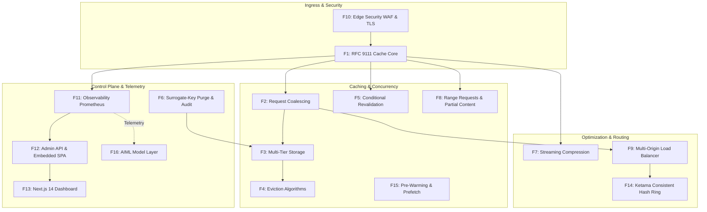
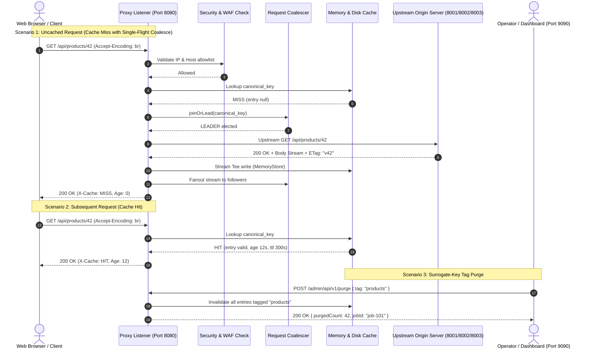

# Full Project Analysis: RFC 9111 CDN Caching Proxy

## 0.1 What the Project Is

### Purpose & Problem Solved
Modern web platforms handle massive volumes of static and dynamic HTTP traffic. Directing all client requests straight to backend application servers and databases causes:
1. **Origin Saturation**: High load spikes (flash sales, breaking news) overwhelm application databases.
2. **Bandwidth Costs**: Origin cloud egress bandwidth is expensive compared to edge caching tiers.
3. **Elevated Latency**: Users located far from the origin experience high network round-trip delays.

`17-cdn-caching-proxy` is a standalone, RFC 9111 compliant reverse caching edge proxy. It intercepts HTTP traffic, validates caching rules, serves repeated requests directly from high-speed memory or local disk, coalesces simultaneous misses, and provides instant cache invalidation.

### Target Users
- **Infrastructure & Platform Engineers**: Deploying edge proxy layers to shield backend microservices.
- **CDN Operators**: Requiring predictable, RFC-compliant caching behavior with granular purge control.
- **Site Reliability Engineers (SREs)**: Monitoring edge hit ratios, origin health, and bandwidth savings.

### Main User & Request Journeys
1. **Cache Hit Journey**: Client issues `GET /images/logo.png`. Proxy looks up the canonical hash key in `MemoryStore`, detects an unexpired entry, validates freshness, sets `X-Cache: HIT`, and pipes the cached stream directly to the client in under 1 millisecond.
2. **Cache Miss & Coalescing Journey**: 500 concurrent clients request `/catalog/item-42`. Proxy detects a cache miss. Rather than flooding the origin with 500 requests, `RequestCoalescer` elects one request as leader. The leader forwards to origin, while 499 followers wait. When origin responds with 200 OK, the stream is tee-piped into the cache store and simultaneously fanned out to all 500 clients.
3. **Cache Purge Journey**: An operator updates product data and issues `POST /admin/api/v1/purge` with tag `category-electronics`. `PurgeIndex` matches 200 cached items, marks them invalidated in memory, and records an immutable cryptographic SHA-256 audit entry.

---

## 0.2 Feature Architecture & Traces (F1 - F16)

The project implements 16 major architectural feature modules, covering 152 distinct verified capabilities:

### Complete Feature Trace Table

| Feature ID | Module & Name | Key Files Involved | Primary Functions | Data Touched | Endpoints Involved |
| :--- | :--- | :--- | :--- | :--- | :--- |
| **F1** | RFC 9111 Cache Core | `src/proxy/request.ts`, `src/cache/lookup.ts`, `src/cache/serve.ts` | `parseRequest`, `lookupCache`, `serveCacheHit` | `CacheEntry`, `MemoryStore` | `GET /*`, `HEAD /*` |
| **F2** | Request Coalescing | `src/proxy/coalesce.ts`, `src/proxy/forward.ts` | `joinOrLead`, `resolveWaiters` | `flightMap`, `passMarkerMap` | `GET /*` |
| **F3** | Multi-Tier Storage | `src/cache/memory-store.ts`, `src/cache/disk-store.ts` | `store`, `get`, `compactSegments` | In-memory Buffer, Disk segments | Internal storage |
| **F4** | Eviction Algorithms | `src/cache/eviction/lru.ts`, `lfu.ts`, `slru.ts`, `ttl.ts` | `onAccess`, `evictNext`, `isTtlEvictable` | Eviction lists, Frequency bins | Internal storage |
| **F5** | Revalidation & 304 | `src/cache/revalidate.ts`, `src/cache/serve.ts` | `handleRevalidationResponse`, `serveCache304` | `CacheEntry.metadata` | `GET /*` (If-None-Match) |
| **F6** | Tag Purge & Audit | `src/purge/api.ts`, `src/purge/index-store.ts`, `src/purge/audit.ts` | `purgeByTag`, `appendAuditEntry` | `tagMap`, `auditLog` SHA-256 chain | `POST /admin/api/v1/purge` |
| **F7** | Streaming Compression | `src/compression/codecs.ts`, `src/compression/negotiate.ts` | `createCompressor`, `negotiateEncoding` | Stream transforms | `GET /*` (Accept-Encoding) |
| **F8** | Range Partial Content | `src/range/parse-range.ts`, `src/cache/large-object.ts` | `parseRangeHeader`, `sliceStream` | Stream slices | `GET /*` (Range) |
| **F9** | Multi-Origin & Circuit | `src/config/origins.ts`, `src/health/circuit-breaker.ts` | `resolveOriginForRequest`, `recordFailure` | `CircuitBreakerState` | Upstream HTTP |
| **F10** | Edge Security WAF | `src/security/ip.ts`, `src/security/host.ts`, `src/security/jwt.ts` | `evaluateIpAccess`, `isHostAllowed`, `verifyToken`| Allow/Deny sets, JWK keys | `/*` (Ingress filter) |
| **F11** | Observability | `src/observability/metrics.ts`, `src/observability/logger.ts` | `recordHit`, `recordMiss`, `logRequest` | Prometheus metrics counters | `GET /metrics` |
| **F12** | Admin Control Plane | `src/admin/server.ts`, `src/admin/routes-manager.ts` | `handle`, `addRoute`, `setPolicy` | Route registry, Policy store | `GET /admin`, `GET /admin/api/v1/*` |
| **F13** | Next.js Dashboard | `frontend/app/dashboard/page.tsx` | `DashboardPage`, `fetchMetrics`, `pollTimeseries`| React state, Recharts | `http://localhost:3000/dashboard` |
| **F14** | Consistent Hashing | `src/cluster/consistent-hashing.ts`, `src/cluster/peer-cluster.ts`| `getNode`, `forwardToPeer` | Ketama ring, Virtual nodes | Peer proxy mesh |
| **F15** | Cache Pre-Warming | `src/warm/warm-prefetch.ts` | `warmUrls`, `prefetchLinkHeaders` | Pre-warm queue | `POST /admin/api/v1/warm` |
| **F16** | AIML Model Layer | `aiml/MODEL_CARD.md`, `eval/evaluate_model.py` | `predict_popularity`, `evaluate` | Telemetry logs, Metric tensors | Async offline evaluation |

---

## 0.3 Every API & Endpoint

### Reverse Proxy Listener (Port 8080)
| Method | Path | Auth | Handler Function | Purpose |
| :--- | :--- | :--- | :--- | :--- |
| `GET / HEAD` | `/*` | Optional (API Key / JWT) | `handleProxyRequest` (`src/proxy/index.ts:180`) | Main reverse caching proxy pipeline |
| `POST / PUT / DELETE` | `/*` | Optional | `forwardUncached` (`src/proxy/forward.ts:35`) | Pass-through non-idempotent mutations to origin |
| `GET` | `/metrics` | None | `metricsRegistry.toPrometheusText()` | Prometheus exposition text format (0.0.4) |
| `GET` | `/_health` | None | Health check endpoint | Returns 200 OK for load balancers |

### Admin Control Plane (Port 9090)
| Method | Path | Auth | Handler Function | Purpose |
| :--- | :--- | :--- | :--- | :--- |
| `GET` | `/admin` or `/` | None | `renderDashboardHtml` | Serves embedded zero-dependency SPA dashboard HTML |
| `GET` | `/admin/api/v1/status` | Bearer Token | `AdminServer.handle` (`src/admin/server.ts:131`) | Returns node health, uptime, and version |
| `GET` | `/admin/api/v1/overview` | Bearer Token | `AdminServer.handle` (`src/admin/server.ts:145`) | Returns total cached objects, bytes, and hit ratio |
| `GET` | `/admin/api/v1/timeseries/:metric`| Bearer Token | `AdminServer.handle` (`src/admin/server.ts:166`) | Returns 1-hour time-series history points |
| `GET` | `/admin/api/v1/origins` | Bearer Token | `AdminServer.handle` (`src/admin/server.ts:174`) | Lists origin health, weights, and circuit breaker status |
| `POST` | `/admin/api/v1/origins/:id/drain` | Bearer Token | `AdminServer.handle` (`src/admin/server.ts:186`) | Marks an origin as drained for maintenance |
| `POST` | `/admin/api/v1/origins/:id/enable`| Bearer Token | `AdminServer.handle` (`src/admin/server.ts:194`) | Re-enables a previously drained origin |
| `GET` | `/admin/api/v1/routes` | Bearer Token | `RouteConfigurationManager.getRoutes` | Retrieves active routing table |
| `POST` | `/admin/api/v1/routes` | Bearer Token | `RouteConfigurationManager.addRoute` | Inserts or updates dynamic route pattern |
| `DELETE` | `/admin/api/v1/routes/:id` | Bearer Token | `RouteConfigurationManager.deleteRoute` | Removes a dynamic route |
| `GET` | `/admin/api/v1/policies` | Bearer Token | `CachePolicyManager.getPolicies` | Retrieves route/tenant cache policy overrides |
| `POST` | `/admin/api/v1/policies` | Bearer Token | `CachePolicyManager.setPolicy` | Sets TTL, bypass, and revalidation policies |
| `GET` | `/admin/api/v1/tenants` | Bearer Token | `MemoryStore.getTenantStats` | Returns per-tenant byte usage and quota limits |
| `GET` | `/admin/api/v1/inspector/decisions`| Bearer Token| `RequestInspector.getRecentDecisions` | Inspects recent caching decisions ring buffer |
| `POST` | `/admin/api/v1/purge` | Bearer Token | `PurgeApiHandler.handleRequest` (`src/purge/api.ts`) | Executes URL, Prefix, Tag, Host, or Tenant purge |
| `GET` | `/admin/api/v1/purge/jobs/:id` | Bearer Token | `PurgeJobQueue.getJobStatus` | Polls status of async background purge job |
| `GET` | `/admin/api/v1/purge/audit` | Bearer Token | `PurgeAuditTrail.getEntries` | Retrieves cryptographic audit log entries |

---

## 0.4 Every Hook, Helper, and Shared Piece

### Next.js Dashboard React Hooks (`frontend/app/dashboard/page.tsx`)
- `useState`: Manages active telemetry metrics, origin lists, route tables, purge forms, and live charts.
- `useEffect`: Sets up a periodic 1-second polling timer against `http://localhost:9090/admin/api/v1/timeseries`.
- `useCallback`: Memoizes API fetchers (`fetchOverview`, `fetchOrigins`, `submitPurge`) to avoid unnecessary re-renders.

### Key Shared Utilities & Helpers
- `src/util/clock.ts`: `Clock` interface with `SystemClock` and `MockClock` for time travel in deterministic tests.
- `src/cache/key.ts`: Canonical cache key builder normalizing query param order and appending `Vary` values.
- `src/cache/cache-control.ts`: Fast parser for RFC 9111 `Cache-Control` directive tokens (`max-age`, `s-maxage`, `no-cache`, `no-store`).
- `src/observability/tracing.ts`: W3C `traceparent` generator and propagator.
- `src/proxy/headers.ts`: RFC 9110 hop-by-hop header scrubber (strips `Connection`, `Keep-Alive`, `Proxy-Authenticate`, `Transfer-Encoding`).

---

## 0.5 System Connection Map

---

## 0.6 Final Inventory Counts

| Metric / Category | Exact Codebase Count | Verification Source |
| :--- | :--- | :--- |
| **Total Major Feature Modules** | **16 Modules** | Grouped F1 - F16 (`docs/features/`) |
| **Total Granular Features** | **152 Features** | Master list in `FEATURES.md` |
| **Total Test Suites** | **151 Suites** | `tests/*.test.ts` (1,064 tests) |
| **Total Endpoints (Proxy & Admin)** | **18 Endpoints** | Documented in `docs/03-api-reference.md` |
| **Frontend Screens / Views** | **3 Views** | Landing, Next.js Dashboard, Embedded Admin SPA |
| **Eviction Algorithms** | **4 Policies** | LRU, LFU, SLRU, TTL (`src/cache/eviction/`) |
| **Compression Codecs** | **3 Codecs** | Brotli, Gzip, Zstandard (`src/compression/`) |
| **Storage Engines** | **2 Tiers** | `MemoryStore` & `DiskStore` (`src/cache/`) |
