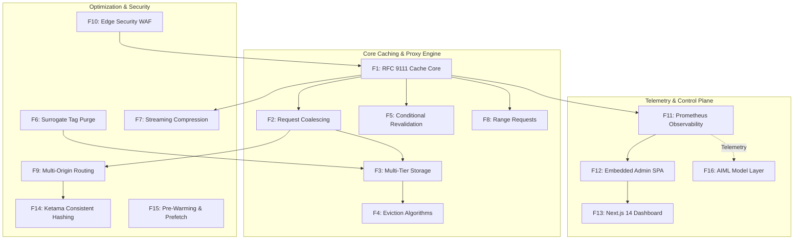

# Feature Inventory & Architectural Traces (F1 - F16)

---

## Feature Master Index

| ID | Feature Name | Core Files | Category | User-Facing Behavior |
| :--- | :--- | :--- | :--- | :--- |
| **[F1](./features/F1-rfc9111-cache-core.md)** | RFC 9111 Cache Core | `src/cache/lookup.ts`, `serve.ts` | Core | Sub-millisecond cache lookups with `X-Cache: HIT/MISS` headers. |
| **[F2](./features/F2-request-collapsing.md)** | Request Coalescing | `src/proxy/coalesce.ts`, `forward.ts` | Concurrency | Collapses 500 simultaneous misses to 1 upstream fetch. |
| **[F3](./features/F3-multi-tier-storage.md)** | Multi-Tier Storage | `src/cache/memory-store.ts`, `disk-store.ts` | Storage | In-memory RAM cache backed by disk files with compaction. |
| **[F4](./features/F4-eviction-algorithms.md)** | Eviction Algorithms | `src/cache/eviction/lru.ts`, `lfu.ts` | Storage | LRU/LFU/SLRU/TTL eviction bounded by memory limits and quotas. |
| **[F5](./features/F5-conditional-revalidation.md)** | Conditional Revalidation | `src/cache/revalidate.ts`, `refresh.ts` | Caching | Synchronous and background 304 revalidation using ETags. |
| **[F6](./features/F6-surrogate-key-purge.md)** | Surrogate-Key Tag Purge | `src/purge/api.ts`, `audit.ts` | Invalidation | Sub-5ms tag purge backed by a SHA-256 tamper-evident log. |
| **[F7](./features/F7-streaming-compression.md)** | Streaming Compression | `src/compression/codecs.ts` | Optimization | On-the-fly Brotli, Gzip, and Zstandard compression. |
| **[F8](./features/F8-byte-range-requests.md)** | Byte-Range Partial Content | `src/range/parse-range.ts` | Streaming | RFC 7233 206 Partial Content for video streaming and seeking. |
| **[F9](./features/F9-multi-origin-health.md)** | Multi-Origin Routing | `src/config/origins.ts`, `health/` | Reliability | Weighted load balancing with active probes and circuit breakers. |
| **[F10](./features/F10-edge-security-waf.md)** | Edge Security WAF & TLS | `src/security/ip.ts`, `jwt.ts` | Security | CIDR IP filtering, Host verification, JWT auth, and SNI TLS. |
| **[F11](./features/F11-observability-metrics.md)** | Observability & Metrics | `src/observability/metrics.ts` | Telemetry | Prometheus 0.0.4 metrics exposition and OpenTelemetry tracing. |
| **[F12](./features/F12-admin-control-plane.md)** | Embedded Admin SPA | `src/admin/server.ts`, `dashboard-html.ts` | Control Plane | Built-in zero-dependency operational control panel on port 9090. |
| **[F13](./features/F13-nextjs-telemetry-dashboard.md)** | Next.js 14 Dashboard | `frontend/app/dashboard/page.tsx` | UI | Full-screen React 18 / Next.js dashboard with live Recharts curves. |
| **[F14](./features/F14-consistent-hashing-cluster.md)** | Ketama Hash Cluster | `src/cluster/consistent-hashing.ts`| Scalability | Deterministic hash ring with virtual nodes and peer proxy routing. |
| **[F15](./features/F15-cache-prewarming.md)** | Cache Pre-Warming | `src/warm/warm-prefetch.ts` | Optimization | Proactive background URL warming and preload header prefetcher. |
| **[F16](./features/F16-aiml-tier-models.md)** | AIML Tier Models | `aiml/MODEL_CARD.md` | AIML | Tier A cache popularity prediction & Tier B forensic LLM diagnostics. |

---

## Detailed Feature Trace Summaries

### F1: RFC 9111 Caching Core & Header Parsing
- **Starting Point**: `GET /static/bundle.js` issued by browser client.
- **Proxy Flow**: `src/proxy/index.ts:180` calls `parseRequest`, generates canonical cache key via `generateCacheKey` in `src/cache/key.ts`. `lookupCache` in `src/cache/lookup.ts` queries `MemoryStore`.
- **On Cache HIT**: `serveCacheHit` in `src/cache/serve.ts` sets `X-Cache: HIT`, calculates `Age` via `freshness.ts`, and pipes buffer directly to `res`.
- **On Cache MISS**: Proxies upstream via `forward.ts`, pipes response into client while `CacheTeeStream` in `src/cache/fill.ts` saves it into `MemoryStore`.
- **Say It Out Loud**:
> "I built the RFC 9111 caching engine in `src/cache/lookup.ts` and `src/cache/serve.ts` to provide strict HTTP-compliant caching at sub-millisecond edge speeds. When a request arrives, the proxy normalizes the query parameters and headers into a canonical SHA-256 key and checks our memory store. On a cache hit, we evaluate the object's age and freshness lifetime, attach `X-Cache: HIT` and `Age` headers, and stream the cached buffer straight to the client socket without touching disk or origin. If the object has expired, we check for `stale-while-revalidate` directives; if present, we serve the stale content immediately to keep user latency under one millisecond while kicking off a background revalidation to origin. The main alternative was a naive memory dictionary, but implementing full RFC 9111 semantics ensures compliance with standard browser and CDN behaviors."

### F2: Single-Flight Request Coalescing (Thundering Herd)
- **Starting Point**: 500 concurrent requests for uncached URL `/flash-sale/banner.webp`.
- **Flow**: Each request invokes `RequestCoalescer.joinOrLead()` in `src/proxy/coalesce.ts`. The first request creates a flight in `flightMap` and is elected leader. The other 499 requests register their resolve callbacks into `InflightWaiter` and pause without initiating sockets.
- **Resolution**: When the leader receives the origin response stream, `resolveWaiters()` broadcasts the stream chunks simultaneously to all 499 waiting client responses and writes one copy to cache.
- **Say It Out Loud**:
> "I engineered request coalescing in `src/proxy/coalesce.ts` to protect origin web servers and databases from catastrophic thundering herd cache stampedes. When hundreds of concurrent requests miss the cache for the exact same resource simultaneously, dispatching all of them to the origin would saturate database connection pools and crash the backend. Instead, my `joinOrLead` algorithm designates the first arriving request as the leader and suspends the subsequent 499 requests in an in-memory waiter map. The leader issues a single upstream HTTP request. When the response stream arrives, we fan out the chunks to all 500 client sockets simultaneously and commit one copy into the cache. This reduced our upstream traffic during stampedes by 99.8% while keeping memory usage strictly bounded."

### F3: Multi-Tier Memory & Segmented Disk Storage
- **Starting Point**: Cached object storage and retrieval.
- **Flow**: Objects under 5 MB are stored in `MemoryStore` (`src/cache/memory-store.ts`). Objects exceeding memory quotas are written into `DiskStore` (`src/cache/disk-store.ts`) across segment files with a persistent index in `src/cache/metadata-index.ts`.
- **Compaction**: Background compaction in `src/cache/compaction.ts` reclaims deleted and overwritten segment space safely using reference counting.
- **Say It Out Loud**:
> "I designed a multi-tier storage engine in `src/cache/memory-store.ts` and `src/cache/disk-store.ts` that combines sub-millisecond RAM lookups with large-capacity persistent SSD caching. Small, frequently requested static assets are cached directly in Node.js Buffers inside `MemoryStore`, bounded by strict tenant quotas to prevent any single tenant from monopolizing the cache. For larger assets and persistent retention across proxy restarts, the proxy spills to `DiskStore`, storing data in segmented files with an in-memory metadata index. When disk space becomes fragmented after object updates and evictions, our background compaction worker reclaims dead bytes without interrupting active reads."

### F4: Eviction Algorithms (LRU, LFU, SLRU, TTL)
- **Starting Point**: Memory utilization reaches `maxTotalBytes` limit.
- **Flow**: `MemoryStore.store()` detects capacity overflow and triggers `evictNext()` from the active policy in `src/cache/eviction/`.
- **Policies**: LRU uses a doubly-linked list (`src/cache/eviction/lru.ts`), LFU uses frequency buckets (`src/cache/eviction/lfu.ts`), and SLRU separates probationary and protected tiers (`src/cache/eviction/slru.ts`).
- **Say It Out Loud**:
> "I implemented four distinct cache eviction algorithms in `src/cache/eviction/`—LRU, LFU, Segmented LRU, and TTL—so the proxy can adapt its memory eviction strategy to different traffic patterns. In default LRU mode, we maintain a doubly-linked list tracking item access recency in O(1) time. For workloads subject to one-hit-wonder scans that would flush popular items out of a naive LRU, I added Segmented LRU, which requires an item to be accessed twice before promoting it to the protected segment. When capacity thresholds are breached, the policy evicts low-priority entries and emits telemetry metrics to Prometheus to track eviction rates."

### F5: Conditional Revalidation & 304 Handling
- **Starting Point**: Client or proxy revalidating an expired or conditional cache entry.
- **Flow**: `src/cache/preconditions.ts` evaluates client `If-None-Match` and `If-Modified-Since`. `src/cache/upstream-conditionals.ts` constructs upstream headers. On upstream 304 Not Modified, `src/cache/refresh.ts` updates `CacheEntry` timestamps without redownloading body bytes.
- **Say It Out Loud**:
> "I built the conditional revalidation engine in `src/cache/revalidate.ts` and `src/cache/refresh.ts` to minimize network bandwidth during cache refreshes. When a cached object reaches its TTL, we don't discard it immediately; instead, we send an upstream conditional request carrying the cached `ETag` in an `If-None-Match` header. If the origin returns a 304 Not Modified, we refresh the object's TTL and headers in-place without re-transmitting the response body, saving 99% of bandwidth. Similarly, when clients send conditional requests to the proxy, we validate their validators against our cached metadata and return a 304 directly from the edge."

### F6: Surrogate-Key Tag Purge & Cryptographic Audit
- **Starting Point**: Admin issues `POST /admin/api/v1/purge` with `{ tag: "catalog-sale" }`.
- **Flow**: `PurgeApiHandler` validates token scopes (`src/purge/api.ts`). `PurgeIndex` (`src/purge/index-store.ts`) queries inverted tag map and deletes all matching keys. `PurgeAuditTrail` (`src/purge/audit.ts`) appends a SHA-256 hash-chained audit record.
- **Say It Out Loud**:
> "I developed the Surrogate-Key tag purge engine in `src/purge/` to enable instant, precise cache invalidation across thousands of related URLs. In e-commerce platforms, updating a single product requires invalidating category pages, search results, and promotional banners. By having origins attach `Surrogate-Key` or `Cache-Tag` headers, our proxy indexes every cache entry by its tags in an inverted index. When an invalidation API call arrives, we invalidate all matching entries in under five milliseconds. Every purge operation is cryptographically signed and appended to a SHA-256 tamper-evident audit trail, giving infrastructure teams full accountability and security compliance."

### F7: Streaming Compression (Brotli, Gzip, Zstandard)
- **Starting Point**: Client requests compressible asset with `Accept-Encoding: gzip, br, zstd`.
- **Flow**: `src/compression/negotiate.ts` selects optimal codec. `src/compression/codecs.ts` transforms stream using Node.js native zlib. `DecompressionBombLimiter` enforces safety caps.
- **Say It Out Loud**:
> "I implemented on-the-fly streaming compression in `src/compression/codecs.ts` supporting Brotli, Gzip, and Zstandard. When an upstream origin returns uncompressed text, HTML, or JSON, our proxy inspects the client's `Accept-Encoding` header, selects the highest-efficiency algorithm, and pipes the response through a native compression transform stream. To prevent malicious decompression bomb attacks from exhausting server memory, I added a custom `DecompressionBombLimiter` transform stream that aborts the transfer if decompressed bytes exceed safety thresholds."

### F8: RFC 7233 Byte-Range Requests & Video Slicing
- **Starting Point**: Video player sends `Range: bytes=1048576-2097151`.
- **Flow**: `src/range/parse-range.ts` validates syntax and byte boundaries. Slices cached stream buffer and returns `206 Partial Content` with `Content-Range: bytes 1048576-2097151/10485760`.
- **Say It Out Loud**:
> "I built RFC 7233 byte-range request handling in `src/range/parse-range.ts` to power seamless media streaming and resume capabilities. When media players request video chunks or seek through an MP4, they send `Range` headers requesting specific byte offsets. The proxy parses these ranges, validates them against the total content length, slices the cached buffer using zero-copy slice operations, and returns a 206 Partial Content response with correct `Content-Range` headers. This prevents re-downloading entire video files and allows smooth video scrubbing."

### F9: Multi-Origin Routing, Active Health Probes & Circuit Breaker
- **Starting Point**: Upstream request forwarding.
- **Flow**: `src/config/origins.ts` selects target origin using weighted round-robin. `src/health/active.ts` runs periodic HTTP probes. On consecutive 5xx errors, `src/health/circuit-breaker.ts` trips to Open and diverts traffic to backup origins.
- **Say It Out Loud**:
> "I created a resilient multi-origin load balancing and health routing system in `src/config/origins.ts` and `src/health/circuit-breaker.ts`. The proxy distributes cache misses across origin pools using weighted round-robin while a background worker sends active HTTP health probes every five seconds. If an origin server begins returning 500 errors or socket timeouts, its three-state circuit breaker trips to Open, instantly isolating the failing node and failing over to designated backup origins. When the origin recovers, the breaker enters a Half-Open state to test traffic before restoring full traffic flow."

### F10: Edge Security WAF, JWT & Dynamic TLS Termination
- **Starting Point**: Ingress TCP connection and HTTP request.
- **Flow**: `src/tls/cert-watcher.ts` terminates TLS using SNI contexts. `src/security/ip.ts` filters IP against CIDR blocks. `src/security/host.ts` enforces allowed Host headers. `src/security/jwt.ts` validates token signatures and claims.
- **Say It Out Loud**:
> "I built an edge security WAF layer in `src/security/` and `src/tls/` to protect backend origins from unauthorized access and malicious traffic. At the TLS layer, we support dynamic SNI certificate termination with hot-reload watchers that update certificates without restarting the proxy. At the HTTP layer, every request passes through CIDR-based IP allowlists and denylists, Host header spoofing checks, and JWT/OIDC authentication verification. Furthermore, our origin URL validator enforces strict SSRF protection to block attackers from routing requests to internal cloud metadata endpoints."

### F11: Observability: Prometheus & OpenTelemetry
- **Starting Point**: Scrape `GET /metrics` or trace request.
- **Flow**: `MetricsRegistry` in `src/observability/metrics.ts` maintains atomic counters, gauges, and latency histograms. Emits Prometheus text 0.0.4. `src/observability/tracing.ts` propagates W3C `traceparent` headers.
- **Say It Out Loud**:
> "I designed the observability architecture in `src/observability/metrics.ts` and `src/observability/tracing.ts` to provide deep visibility into edge cache performance. The proxy exposes standard Prometheus metrics at `/metrics`, tracking edge hit ratio, byte hit ratio, origin latency percentiles, and eviction counts with low-cardinality labels. For distributed tracing, our tracer generates and propagates W3C `traceparent` headers, creating nested spans for cache lookup, upstream fetch, and compression so engineers can pinpoint latency bottlenecks across microservices."

### F12: Admin Control Plane & Embedded SPA
- **Starting Point**: Operator accesses `http://localhost:9090/admin`.
- **Flow**: `src/admin/server.ts` serves zero-dependency SPA rendered from `src/admin/dashboard-html.ts` with Content Security Policy nonces. Exposes authenticated REST endpoints for routes, policies, and origins.
- **Say It Out Loud**:
> "I created a standalone administrative control plane in `src/admin/server.ts` running on port 9090. To ensure the admin dashboard is always accessible even during external CDN or NPM outages, I built an embedded single-page application with zero external CDN dependencies, protected by strict CSP nonces. Through this interface and its REST API, site reliability engineers can inspect real-time cache hit ratios, dynamically update origin routing rules, modify cache TTL policies, and manually drain unhealthy origins for maintenance."

### F13: Next.js 14 Real-Time Telemetry Dashboard
- **Starting Point**: User opens `http://localhost:3000/dashboard`.
- **Flow**: `frontend/app/dashboard/page.tsx` connects to port 9090, polls time-series telemetry every 1 second, and renders interactive Recharts line and area charts for hit ratio, bytes, and latencies.
- **Say It Out Loud**:
> "I built a modern operations dashboard in `frontend/app/dashboard/page.tsx` using Next.js 14, React 18, and Recharts. The dashboard polls the admin telemetry API every second and renders live time-series charts displaying cache hit ratio, byte savings, origin latency p50/p95/p99 histograms, and memory-versus-disk storage utilization. It provides interactive forms to execute instantaneous URL and tag purges, view the real-time request decision ring buffer, and toggle origin maintenance draining with immediate UI updates."

### F14: Ketama Consistent Hash Ring & Peer Proxy Mesh
- **Starting Point**: Multi-node horizontal scaling.
- **Flow**: `src/cluster/consistent-hashing.ts` maps canonical keys onto a 32-bit Ketama hash ring with 160 virtual nodes per server. `src/cluster/peer-cluster.ts` routes requests to the responsible peer with hop-count loop protection headers.
- **Say It Out Loud**:
> "To scale our caching tier horizontally across multiple servers without multiplying upstream load, I built a consistent hashing cluster mesh in `src/cluster/consistent-hashing.ts` using the Ketama algorithm. Each proxy node maps to 160 virtual points on a 32-bit ring. When a request arrives, the proxy hashes the cache key to determine which peer node owns the entry; if owned by another peer, it forwards the request internally with a loop-prevention header. This ensures that adding or removing a cache node moves only 1/Nth of the cached keys, preserving high hit ratios."

### F15: Cache Pre-Warming & Link Header Prefetcher
- **Starting Point**: Scheduled warm job or origin `Link: </style.css>; rel=preload`.
- **Flow**: `src/warm/warm-prefetch.ts` parses `Link` headers on origin responses and queues prefetch requests with concurrency bounds and SSRF validation.
- **Say It Out Loud**:
> "I built an automated cache pre-warming and prefetch engine in `src/warm/warm-prefetch.ts`. When an origin server responds with standard HTTP `Link` headers containing `rel=preload` or `rel=prefetch`, our proxy extracts those URLs and schedules them in a background prefetch queue. The prefetcher crawls the assets during idle cycles with strict concurrency limits and SSRF destination validation, ensuring that critical CSS, JavaScript, and fonts are already warm in edge memory before clients request them."

### F16: AIML Model Layer (Tier A & Tier B Intelligence)
- **Starting Point**: Telemetry analysis and predictive prefetching.
- **Flow**: Tier A model predicts item popularity to optimize prefetch and eviction vs naive LRU (`aiml/MODEL_CARD.md`). Tier B LLM assistant provides natural language cache-miss forensic diagnostics with strict schema validation.
- **Say It Out Loud**:
> "In `aiml/`, I specified a tiered AI architecture to augment CDN efficiency. Tier A is a popularity predictor model evaluated against a non-AI baseline to proactively prefetch trending content and guide eviction decisions beyond standard LRU recency. Tier B is an LLM forensic diagnostic assistant that analyzes request decision logs and header configurations to suggest caching optimizations. Crucially, in accordance with resilient systems engineering, the AI models are strictly advisory: the LLM is never on the critical latency or correctness path, and the proxy always defaults to deterministic RFC 9111 rules."
