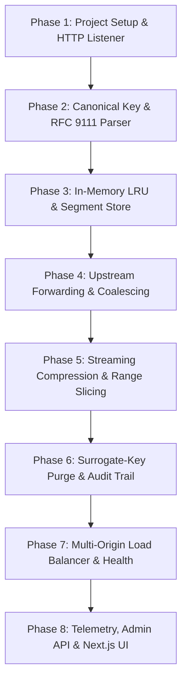

# Step-by-Step Rebuild Guide: RFC 9111 CDN Caching Proxy

This guide documents the exact dependency-ordered sequence for rebuilding `17-cdn-caching-proxy` from a blank directory.



---

## Phase 1: Ingress Listener & Stream Pipeline
1. **Initialize Project**:
   ```bash
   npm init -y
   npm install zod
   npm install -D typescript vitest tsx @types/node selfsigned
   ```
2. **Create Ingress Listener** (`src/proxy/listener.ts`):
   - Wrap Node.js `http.createServer` and `https.createServer`.
   - Setup SNI certificate dispatch (`src/tls/cert-watcher.ts`).
3. **Key Code Implementation**:
   ```typescript
   // src/proxy/listener.ts:25
   export function createProxyServer(handler: (req: http.IncomingMessage, res: http.ServerResponse) => void): http.Server {
     return http.createServer((req, res) => {
       req.on('error', (err) => console.error('[client-req-err]', err));
       res.on('error', (err) => console.error('[client-res-err]', err));
       handler(req, res);
     });
   }
   ```
   *Explanation*: Binds client socket error listeners immediately to prevent uncaught socket hangup crashes.

---

## Phase 2: Canonical Cache Keys & RFC 9111 Freshness
1. **Canonical Cache Key Generator** (`src/cache/key.ts`, `src/cache/key-normalize.ts`):
   - Lowercase hostname and scheme.
   - Sort URL query parameters alphabetically (`foo=1&bar=2` becomes `bar=2&foo=1`).
   - Append secondary key hashes from `Vary` headers (`Accept-Encoding`).
2. **RFC 9111 Cache-Control Parser** (`src/cache/cache-control.ts`):
   - Parse `max-age`, `s-maxage`, `no-cache`, `no-store`, `stale-while-revalidate`.

---

## Phase 3: Multi-Tier Memory & Disk Storage
1. **MemoryStore** (`src/cache/memory-store.ts`):
   - Allocate in-memory Buffers indexed by canonical SHA-256 keys.
   - Bound by `maxTotalBytes` and `maxObjectBytes`.
2. **Eviction Policies** (`src/cache/eviction/`):
   - Implement `LruPolicy` using doubly-linked list nodes.
   - Add `SlruPolicy` (Segmented LRU) to isolate probationary vs protected entries.
3. **Key Code Implementation**:
   ```typescript
   // src/cache/memory-store.ts:65
   public store(keyHash: string, entry: CacheEntry): boolean {
     if (entry.body.length > this.maxObjectBytes) return false;
     while (this.currentBytes + entry.body.length > this.maxTotalBytes) {
       const evictedKey = this.evictionPolicy.evictNext();
       if (!evictedKey) break;
       this.delete(evictedKey);
     }
     this.entries.set(keyHash, entry);
     this.currentBytes += entry.body.length;
     return true;
   }
   ```

---

## Phase 4: Request Coalescing (Thundering Herd Protection)
1. **In-Flight Flight Coordinator** (`src/proxy/coalesce.ts`):
   - Maintain `Map<string, InflightFlight>`.
   - First request becomes leader; subsequent requests await stream fanout.
2. **Key Code Implementation**:
   ```typescript
   // src/proxy/coalesce.ts:38
   public joinOrLead(keyHash: string, requestId: string): { isLeader: boolean; waitPromise?: Promise<CoalesceResult> } {
     const existing = this.flightMap.get(keyHash);
     if (existing) {
       const promise = new Promise<CoalesceResult>((resolve, reject) => {
         existing.waiters.set(requestId, { requestId, resolve, reject });
       });
       return { isLeader: false, waitPromise: promise };
     }
     this.flightMap.set(keyHash, { keyHash, leaderRequestId: requestId, waiters: new Map(), createdAt: Date.now() });
     return { isLeader: true };
   }
   ```

---

## Phase 5: Streaming Compression & Range Slicing
1. **Compression Pipeline** (`src/compression/codecs.ts`):
   - Implement on-the-fly streaming `zlib.createBrotliCompress()` and `zlib.createGzip()`.
   - Add `DecompressionBombLimiter` transform to prevent zip-bomb heap exhaustion.
2. **Range Parser** (`src/range/parse-range.ts`):
   - Parse `Range: bytes=start-end` and slice stream directly to output `206 Partial Content`.

---

## Phase 6: Surrogate-Key Tag Purge & Audit Trail
1. **Inverted Index Store** (`src/purge/index-store.ts`):
   - Index entries by tag: `Map<string, Set<string>>`.
2. **Tamper-Evident Audit Chain** (`src/purge/audit.ts`):
   - Hash each purge entry with `crypto.createHash('sha256')` linked to the previous entry hash.

---

## Phase 7: Multi-Origin Load Balancing & Health Probes
1. **Origin Pools** (`src/config/origins.ts`):
   - Support weighted round-robin distribution.
2. **Active Health Probes** (`src/health/active.ts`) & **Circuit Breaker** (`src/health/circuit-breaker.ts`):
   - Probe endpoints every 5 seconds. Trip to Open after 3 consecutive failures.

---

## Phase 8: Telemetry, Admin API & Next.js UI
1. **Prometheus Metrics** (`src/observability/metrics.ts`):
   - Expose counters, gauges, and histograms at `GET /metrics`.
2. **Admin Server** (`src/admin/server.ts`):
   - Run on port 9090 with Bearer token authentication and embedded SPA (`dashboard-html.ts`).
3. **Next.js Dashboard** (`frontend/app/dashboard/page.tsx`):
   - Poll telemetry API and visualize hit ratio, latency, and cache sizes via Recharts.
