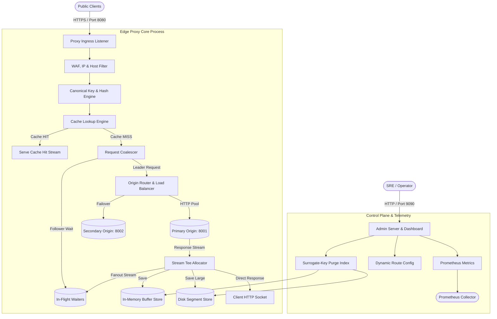
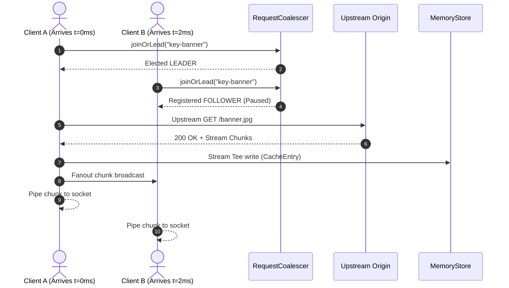

# Architecture & End-to-End System Design

## 1. High-Level Architecture Overview

---

## 2. Request Lifecycle Traces

### 2.1 Cache Hit Lifecycle (< 1 ms)
1. Client sends `GET /static/app.js` with `Accept-Encoding: br`.
2. `src/proxy/index.ts` validates Host header and IP allowlist.
3. `src/cache/key.ts` computes canonical SHA-256 hash: `sha256(https://example.com/static/app.js + vary:br)`.
4. `src/cache/lookup.ts` finds matching `CacheEntry` in `MemoryStore`.
5. `src/cache/freshness.ts` verifies: `current_age < max_age`.
6. `src/cache/serve.ts` sets `X-Cache: HIT`, `Age: 42`, and pipes buffer directly to downstream client socket.

### 2.2 Cache Miss with Single-Flight Coalescing

---

## 3. Scaling to 100x Traffic & Bottleneck Elimination

At 100x traffic (50,000+ requests per second):
1. **Bottleneck 1: Node.js Single-Threaded Event Loop**:
   - *Fix*: Scale proxy horizontally across multi-core servers using Linux `SO_REUSEPORT` kernel socket load balancing or deploy multi-process worker clusters.
2. **Bottleneck 2: In-Memory Heap GC Pressure**:
   - *Fix*: Migrate from V8 heap Buffer allocation to native C++ off-heap slab allocators or Rust/Hyper proxy engine (`backend/`).
3. **Bottleneck 3: Centralized Purge Broadcast**:
   - *Fix*: Replace in-process purge events with a distributed Redis Pub/Sub or Kafka invalidation bus.
