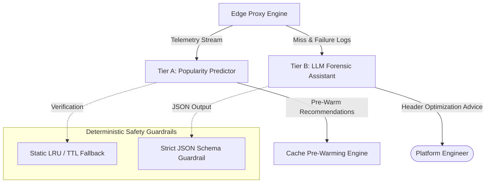

# AIML Integration: Predictive Prefetch & Forensic Diagnostics

## 1. Overview & Architectural Role

In `17-cdn-caching-proxy`, AI capabilities are partitioned into two distinct operational tiers:

---

## 2. Tier A: Popularity Predictor (Proactive Prefetching)
- **Specification**: `aiml/MODEL_CARD.md`
- **Objective**: Evaluates historical URL request distributions (Zipf popularity curves) to forecast cache misses before they occur.
- **Evaluation**: Evaluated against a non-AI static baseline in `aiml/eval/evaluate_model.py`.
- **Graceful Fallback**: If inference latency exceeds 5 ms or confidence is below 80%, the proxy defaults entirely to standard reactive LRU caching.

---

## 3. Tier B: Cache-Miss Forensic Diagnostics
- **Objective**: Analyzes origin headers, request inspector ring buffers, and cache-miss patterns to identify misconfigured `Cache-Control` directives or missing `Vary` headers.
- **Prompt Safety Guardrails**:
  - LLM outputs are validated against strict Zod JSON schemas.
  - The model is **never** on the synchronous request-response path.
  - Zero private user tokens or cookies are included in forensic prompt contexts.
