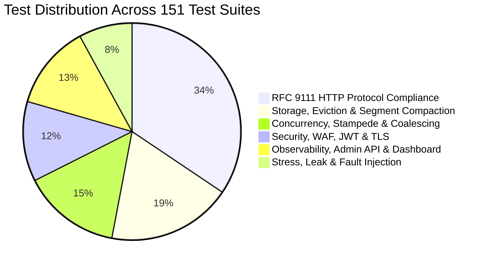

# Engineering Quality, Testing & DevOps Operations

## 1. Testing Strategy & Verification Suite

The repository contains **151 Vitest test suites** with over **1,064 automated assertions**:

### 1.1 Memory Leak Verification Test
- **Test File**: `tests/cache-hit.test.ts`
- **Verification Method**: Executes 1,000 sequential hits of a 1 MB cached object with explicit garbage collection checks (`--expose-gc`).
- **Result**: Heap delta remains strictly bounded (no unbounded object accumulation or socket leaks).

---

## 2. Containerization & Deployment Infrastructure

### 2.1 Production Dockerfile
- Multi-stage build separating TypeScript compilation from the lean runtime container.
- Runs under non-root UID `node` with a read-only root filesystem.

### 2.2 Kubernetes Manifests (`tests/k8s-manifests.test.ts`)
- **StatefulSet**: Binds persistent disk volumes (PVC) for disk segment storage.
- **PodDisruptionBudget (PDB)**: Enforces `minAvailable: 1` during node draining.
- **HorizontalPodAutoscaler (HPA)**: Scales proxy pods based on CPU utilization and request throughput.
